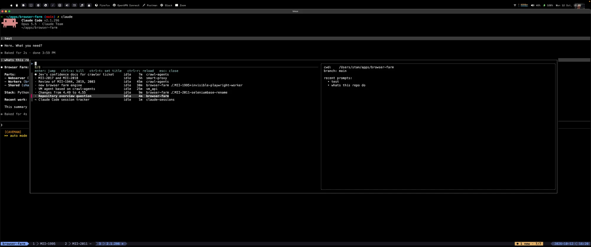

# claude-sessions

One place for every Claude Code session running in tmux: which are busy, which
are waiting for you, and which of those you have not looked at yet. The moment a
session finishes and needs your input you get a macOS notification and a
sound, and the tmux status bar shows how many are waiting.

Reads Claude Code's own session registry (`~/.claude/sessions/*.json`, plus any
extra profiles under `~/.claude-profiles/`). No hooks, no daemon, no polling of
pane contents.

## Requirements

- macOS (uses `osascript` for notifications and `ps -o lstart` for liveness)
- tmux >= 3.2 (`display-popup`)
- bash >= 4.4 on PATH (`brew install bash`), jq, fzf
- Claude Code >= 2.1.288. The registry format is undocumented; a Claude Code
  update may change it. When that happens the status segment shows a red `!`
  and `~/.cache/claude-sessions/errors.log` says why.

## Install

    git clone https://github.com/stanislav-milchev/claude-sessions
    cd claude-sessions && ./install.sh

Then add the printed tmux snippet to `~/.tmux.conf`.

## Use

- Status bar: `○ 0/4` nothing waiting · `● 2/4` two waiting, all seen ·
  `● 1 new · 2/4` one you have not looked at (highlighted) · `!` a tick failed.
- `prefix g`: popup list. Enter jumps to the pane. `ctrl-x` kills the session
  after a y/N prompt (its tmux pane, or the process for a desktop-app session).
  `ctrl-t` sets your own title for a session. `ctrl-r` reloads. Preview on the
  right shows cwd, branch and recent prompts.
- Looking at a pane acknowledges it. A session becoming ready sends a macOS
  notification and plays a sound (Glass by default, configurable). The first tick after install seeds state
  silently so already-idle sessions do not all fire at once.

Row markers: `●` waiting and unseen · `·` waiting and seen · blank busy ·
`~` desktop-app session (no tmux pane, cannot jump).

## Titles

Row title precedence: your `ctrl-t` override, then `/rename` in Claude Code,
then Claude's auto title (taken from the tmux pane title).

## Resume after reboot

`tmux-claude-resume` brings every Claude pane back to its own conversation after
a reboot, even when several panes share one directory (where `claude --continue`
would pick the same session for all of them). It hooks into
[tmux-resurrect](https://github.com/tmux-plugins/tmux-resurrect):

- `save` (after each resurrect save) finds the `claude` process under every pane,
  looks up its session id and config dir in the registry, and writes
  `claude-sessions.tsv` next to the resurrect snapshot.
- `restore` (after resurrect restores) types
  `cd <cwd> && CLAUDE_CONFIG_DIR=<dir> claude --resume <id>` into each pane that
  is back at a shell prompt. The config dir prefix is left out for `~/.claude`.
- `restore --dry-run` prints those commands instead; `show` prints the saved list.

With [tmux-continuum](https://github.com/tmux-plugins/tmux-continuum) saving
every few minutes and restoring on tmux start:

    set -g @plugin 'tmux-plugins/tpm'
    set -g @plugin 'tmux-plugins/tmux-resurrect'
    set -g @plugin 'tmux-plugins/tmux-continuum'
    set -g @continuum-restore 'on'
    set -g @continuum-save-interval '5'
    set -g @resurrect-hook-post-save-all '$HOME/.local/bin/tmux-claude-resume save'
    set -g @resurrect-hook-post-restore-all '$HOME/.local/bin/tmux-claude-resume restore'
    run '~/.tmux/plugins/tpm/tpm'

A session opened or `/clear`ed after the last save is not captured; `prefix C-s`
saves on demand.

## Configuration

All optional, via environment variables in your shell profile:

| Variable | Default | Purpose |
|---|---|---|
| `CLAUDE_SESSIONS_CONFIG_DIRS` | `$HOME/.claude` + every `$HOME/.claude-profiles/*` | Claude config dirs to scan, colon-separated (also used by `tmux-claude-resume`). First one is the default profile; sessions from the others show `(profile)` after the repo |
| `CLAUDE_SESSIONS_BASE_DIRS` | `$HOME/apps:$HOME/personal` | Roots stripped from cwd for the repo column; worktrees under them render as `repo ⎇ branch` |
| `CLAUDE_SESSIONS_STYLE_NEW` | `#[fg=#16161e,bg=#e0af68,bold]` | tmux style when unseen sessions exist |
| `CLAUDE_SESSIONS_STYLE_READY` | `#[fg=#7aa2f7]` | style when sessions wait but all are seen |
| `CLAUDE_SESSIONS_STYLE_QUIET` | `#[fg=#565f89]` | style when nothing waits |
| `CLAUDE_SESSIONS_STYLE_ERROR` | `#[fg=#f7768e,bold]` | style of the `!` marker |
| `CLAUDE_SESSIONS_SOUND` | `/System/Library/Sounds/Glass.aiff` | sound played when a session becomes ready; any file `afplay` can play, empty disables it |

## Dev

    brew install bats-core
    bats tests/

Test-only overrides: `CLAUDE_SESSIONS_STATE`, `CLAUDE_SESSIONS_ALIVE_CMD`,
`CLAUDE_SESSIONS_KILL_CMD`, `CLAUDE_SESSIONS_NOW_MS`.
